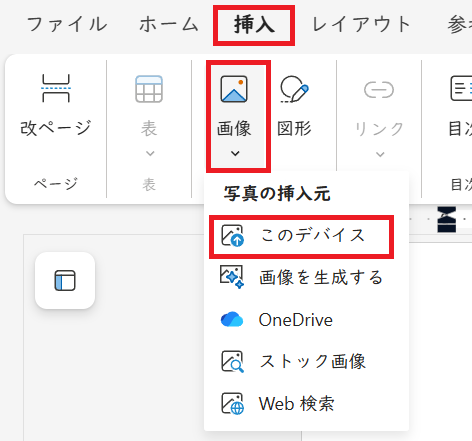
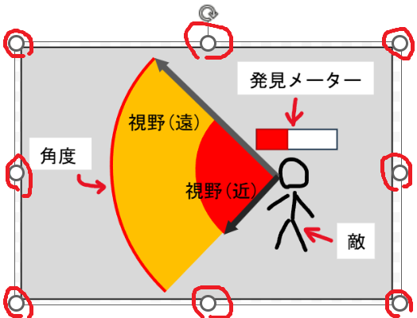
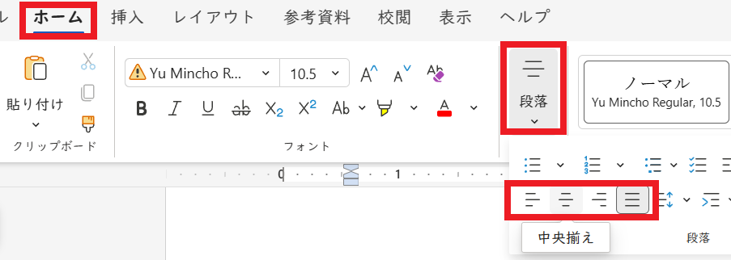
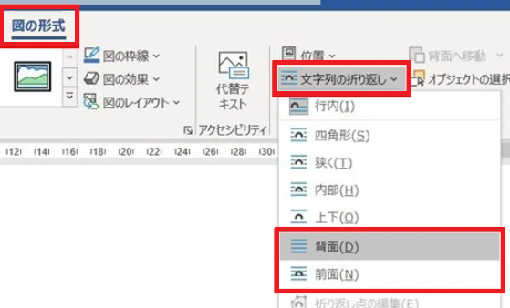

# Word文書に画像を追加する

## 1 画像の追加

### 1.1 敵の視野の仕様を書く

とある「忍者ゲーム」の目的は、 **できるだけ敵に見つからないようにゴールに辿り着くこと** です。 
このゲームを成立させるには、「敵はどのようにプレイヤーを見つけるのか」を決めておく必要があります。

そこで、敵には「視野」と、「発見メーター」の２つを設定します。

「視野」は、敵の正面に「扇形(おうぎがた)」の範囲として設定されます。 
プレイヤーが視野に入ると、「発見メーター」の数値が0から100まで徐々に増えていきます。 
そして、発見メーターが100になると、プレイヤーは敵に発見されます。

そういうわけで、扇形の視野の仕様書を書いてみます。

<pre class="tnmai_assignment">
<strong>【課題１】</strong>
新しい「白紙の文書」を作成し、以下の文章と箇条書きを追加しなさい。
<code>
忍者ゲームの敵の視野の仕様{タイトル}　　　　　　　　　　　　　　　
　　　　　　　　　　　　　　　　　　　　　　　　　　　　　　　
敵がプレイヤーを発見する仕組み{見出し１}　　　　　　　　　　　　　 
敵は「視野(しや)」と「発見メーター」を持つ。　　　　　　　　　　　　　　
　　　　　　　　　　　　　　　　　　　　　　　　　　　　　　　
視野{見出し１}　　　　　　　　　　　　　　　　　　　　　　　　
敵の頭部から前方に広がる扇状の範囲。画面には表示されない。　　　　　
範囲は以下の３つのパラメータで定義する。値は敵の種類によって異なる。　　
* 角度：扇の幅を決める0～360度の角度。　　　　　　　　　　　　　
* 近距離：この範囲にプレイヤーが入ると即座に発見される。　　　　　　　
* 遠距離：この範囲にプレイヤーが入ると「発見メーター」の値が増える。　　　
　　　　　　　　　　　　　　　　　　　　　　　　　　　　　　　
発見メーター{見出し１}　　　　　　　　　　　　　　　　　　　　　 
敵の頭上に表示される棒グラフで、プレイヤーを発見するまでの時間をあらわす。 
値の範囲は0から100。値が0のときは表示されない。1以上になると表示される。
値が100になるとプレイヤーを「発見」する。　　　　　　　　　　　　　　　
</code></pre>

これで、仕様書として必要な情報はある程度揃います。

ですが、文章だけだと、実際にプログラムやデザインのイメージは浮かびにくいです。 
というのも、「形や配置を文章で説明するのは難しい」からです。 
このような場合、画像や図形を使うと分かりやすくなります。

画像はこちらで用意しました。以下の課題２を完了させて、画像をコピーしてください。

<pre class="tnmai_assignment">
<strong>【課題２】</strong>
以下の手順に従って、敵の視野の画像をダウンロードし、ZIPファイルを展開しなさい。

1. ブラウザで以下のページを開く。
   <code>github.com/tn-mai/tool_operation_2025/main/data</code>
2. 「<strong>忍者ゲーム_敵の視野の図.zip</strong>」というファイル名をクリック。
3. 右のほうにある<strong>下向き矢印</strong>のアイコンにマウスカーソルを合わせる。
    (<code>Download raw file</code>と表示されるはず)
4. <strong>下向き矢印</strong>アイコンをクリック。
5. ダウンロード先を選んでファイルを保存。
</pre>

### 1.2 文書に画像を入れる

文書に画像を追加するには、追加したい場所にカーソルを移動させ、Enterキーで空行を作ります。 
次に、「挿入(そうにゅう)」タブにある「画像」ボタンをクリックします。

「画像の保管場所」のリストが表示されるので「このデバイス」を選んでください。

> 「このデバイス」とは「自分のPC」のことです。

<pre class="tnmai_assignment">
<strong>【課題３】</strong>
文書の末尾に、課題２でダウンロードした「敵の視野_基本.png」を挿入しなさい。
</pre>

### 1.3 画像の大きさを変える

画像の大きさを変えるには、まず画像をクリックして選択状態にします。 
すると、上下左右と四隅の８ヶ所に、丸い「アンカー」が表示されます。 
アンカーをドラッグすると、画像の大きさを変えられます。

<pre class="tnmai_assignment">
<strong>【課題４】</strong>
課題３で追加した画像の「右下のアンカー」をドラッグして、横の長さをページの半分にしなさい。
</pre>

### 1.4 画像の位置を調整する

追加した画像の位置を調整する方法は、２つあります。

最初の方法は「ホーム」タブの「段落」ボタンを使うことです。 
「左揃え」、「中央揃え」、「右揃え」を選ぶと、画像の位置を左、中央、右に設定できます。

別の方法は、画像を選択したときに表示される「図の形式」タブから、「文字列の折り返し」を選ぶことです。 
折り返しの種類として「背面」または「前面」を選ぶと、画像を自由に移動できます。 
「背面」の場合、画像は文章の下に表示されます。「前面」の場合、画像は文章の上に表示されます。

<pre class="tnmai_assignment">
<strong>【課題５】</strong>
課題３で追加した画像を「中央揃え」に設定しなさい。
</pre>

### 1.5 複数の画像を左右に並べる

画像を左右に並べるには、並べたい画像の幅の合計が、ページの幅以下でなくてはなりません。 
ページの幅以下なら、好きな順番で画像を並べられます。

あるいは、「文字列の折り返し」で「背面」や「前面」を選ぶことでも、画像を並べられます。

<pre class="tnmai_assignment">
<strong>【課題６】</strong>
課題３で追加した画像の下に、以下の文章と新しい画像を追加しなさい。
画像のサイズを調整して、3つの画像を同じ行に並べること。

<code>
発見メーターの増減{見出し１}　　　　　　　　　　　　　　　　　 
　　　　　　　　　　　　　　　　　　　　　　　　　　　　　　
プレイヤーが遠距離の範囲に入ると、1/60秒ごとに1ずつ増える。　　　　　
「通常状態」のとき、プレイヤーが視野の外にいると、1/60秒ごとに2ずつ減る。
プレイヤーが近距離の範囲に入ると、即座に100になる(「攻撃状態」になる)。
　　　　　　　　　　　　　　　　　　　　　　　　　　　　　　
  {敵の視野_発見メーター_増加.png}　　　　　　　　　　　　　　
  {敵の視野_発見メーター_減少.png}　　　　　　　　　　　　　　
  {敵の視野_発見メーター_100になる.png}　　　　　　　　　　　　
</code></pre>

<pre class="tnmai_assignment">
<strong>【課題７】</strong>
課題６で追加した画像の下に、以下の文章と新しい画像を追加しなさい。
<code>
発見メーターが100%になったとき{見出し１}　　　　　　　　　　　　　　　　　
発見メーターが100%になった瞬間、発見メーターを強く光らせる。　　　　　　　　　 
その後は、1秒ごとに1回、弱く光らせる。　　　　　　　　　　　　　　　　　　 
　　　　　　　　　　　　　　　　　　　　　　　　　　　　　　　　　　
{敵の視野_発見メーター_強い発光.png} {敵の視野_発見メーター_弱い発光.png}
　　　　　　　　　　　　　　　　　　　　　　　　　　　　　　　　　　
プレイヤーを見失ったとき{見出し１}　　　　　　　　　　　　　　　　　　　　
プレイヤーが5秒以上視界から外れ続けると、「通常状態」に戻る。　　　　　　　　 
発見メーターの点滅が止まり、値が1/60秒ごとに2ずつ減る。　　　　　　　　　　　
　　　　　　　　　　　　　　　　　　　　　　　　　　　　　　　　　　
{敵の視野_発見メーター_減少.png} {敵の視野_発見メーター_非表示.png} 　　
　　　　　　　　　　　　　　　　　　　　　　　　　　　　　　　　　　
発見メーターが100になる前に隠れ身を実行したとき{見出し１}　　　　　　　　  
プレイヤーが視界外にいるときと同じ扱い。　　　　　　　　　　　　　　　　　 
1/60秒ごとに発見メーターの値が2ずつ減る。　　　　　　　　　　　　　　　　 
　　　　　　　　　　　　　　　　　　　　　　　　　　　　　　　　　　
{敵の視野_発見メーター_隠れ身状態.png}　　　　　　　　　　　　　　　　
</code></pre>

<pre class="tnmai_assignment">
<strong>【課題８】</strong>
課題７で追加した文章と画像の下に、以下の文章と新しい画像を追加しなさい。

<code>
プレイヤーを見つける仕組み{見出し１}　　　　　　　　　　　　　　　 
敵の視野の原点から、プレイヤーの頭と足もとの2ヶ所に向けてレイキャストを行う。
　　　　　　　　　　　　　　　　　　　　　　　　　　　　　　　
  {敵の視野_レイキャスト.png}　　　　　　　　　　　　　　　　　　
　　　　　　　　　　　　　　　　　　　　　　　　　　　　　　　
レイがどちらも視野の角度の外にある場合、発見メーターを2減らす。　　　　　
　　　　　　　　　　　　　　　　　　　　　　　　　　　　　　　
  {敵の視野_レイキャスト_2本とも角度の外.png}　　　　　　　　　　 
　　　　　　　　　　　　　　　　　　　　　　　　　　　　　　　
両方のレイが視野の角度以内の場合、短い方のレイの長さを採用する。　　　
　　　　　　　　　　　　　　　　　　　　　　　　　　　　　　　
  {敵の視野_レイキャスト_2本とも角度内.png}　　　　　　　　　　　 
　　　　　　　　　　　　　　　　　　　　　　　　　　　　　　　
どちらかのレイだけが視野の角度以内の場合、そのレイの長さを採用する。　　 
　　　　　　　　　　　　　　　　　　　　　　　　　　　　　　　
  {敵の視野_レイキャスト_1本だけ角度内.png}　　　　　　　　　　　
　　　　　　　　　　　　　　　　　　　　　　　　　　　　　　　
採用したレイの長さが「近距離」以下の場合、発見メーターを100にする。　　　
　　　　　　　　　　　　　　　　　　　　　　　　　　　　　　　
  {敵の視野_レイキャスト_近距離.png}　　　　　　　　　　　　　　 
　　　　　　　　　　　　　　　　　　　　　　　　　　　　　　　
採用したレイの長さが「遠距離」以下の場合、発見メーターを1増やす。　　　　
　　　　　　　　　　　　　　　　　　　　　　　　　　　　　　　
  {敵の視野_レイキャスト_遠距離.png}　　　　　　　　　　　　　　 
　　　　　　　　　　　　　　　　　　　　　　　　　　　　　　　
採用したレイの長さが「遠距離」より長い場合、発見メーターを2減らす。　　　 
　　　　　　　　　　　　　　　　　　　　　　　　　　　　　　　
  {敵の視野_レイキャスト_範囲外.png}　　　　　　　　　　　　　　 
</code></pre>
